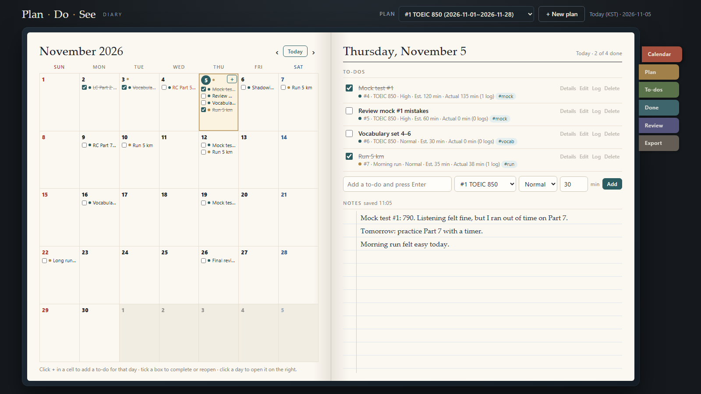
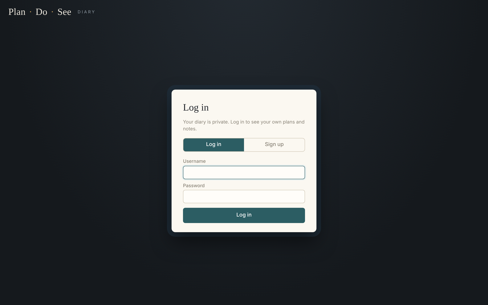
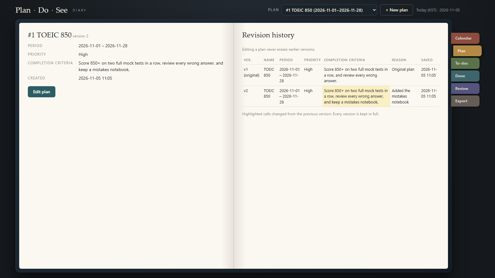
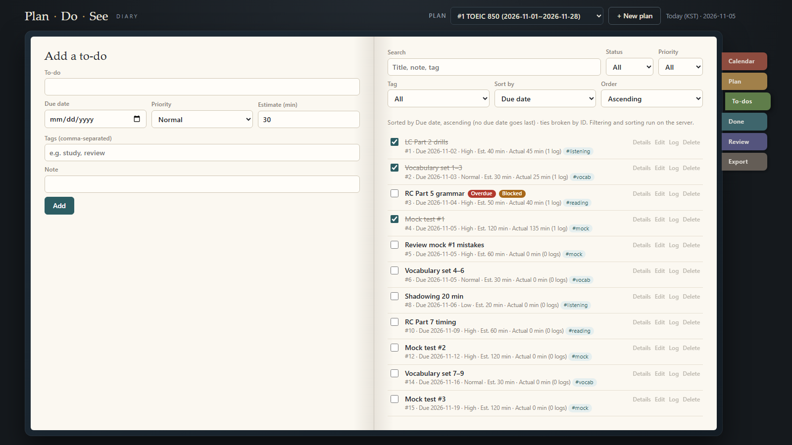
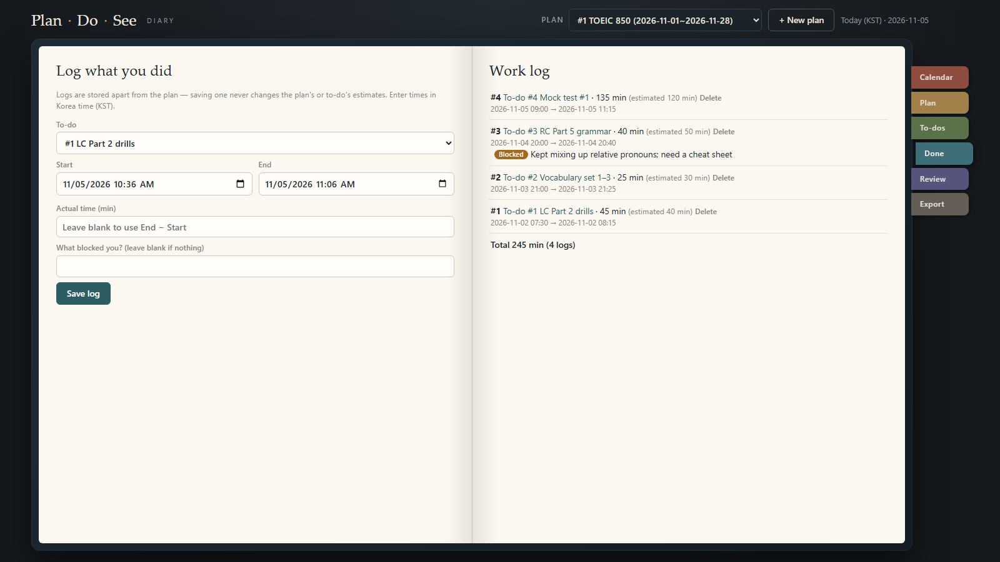
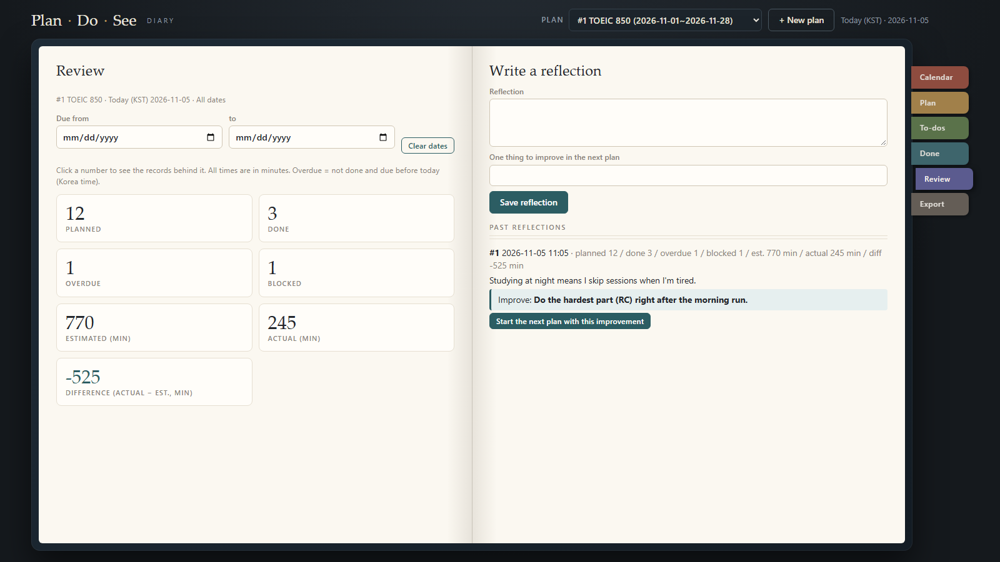
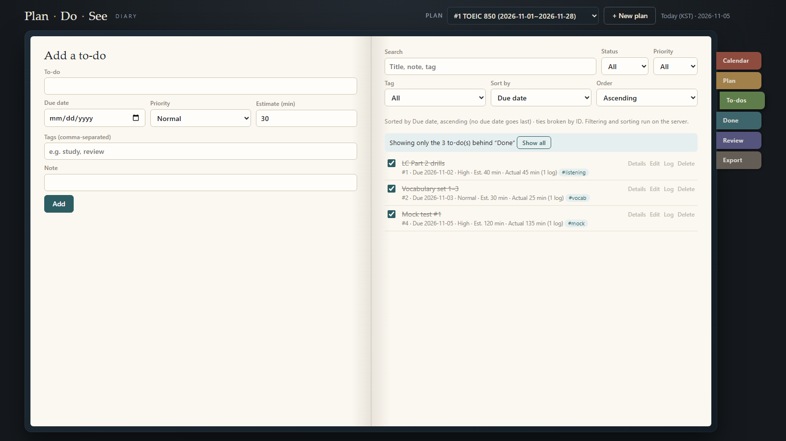

# 플랜두씨 다이어리 — 사용 설명서

**계획(Plan) → 실제로 한 일(Do) → 돌아보기(See)** 를 한 권의 다이어리에서 이어서 기록하는 웹 앱입니다.

- 바로 쓰기: **https://alstn.pythonanywhere.com**
- 소스: https://github.com/Lee-Minsoo6944/PDS-Diary


---
## 목차
1. [화면 둘러보기](#1-화면-둘러보기)
2. [처음 시작하기](#2-처음-시작하기)
3. [Calendar — 달력과 하루 메모](#3-calendar--달력과-하루-메모)
4. [Plan — 계획 세우고 고치기](#4-plan--계획-세우고-고치기)
5. [To-dos — 할 일 관리](#5-to-dos--할-일-관리)
6. [Done — 실제로 한 일 기록](#6-done--실제로-한-일-기록)
7. [Review — 돌아보기](#7-review--돌아보기)
8. [Account — 내보내기·비밀번호·계정 삭제](#8-account--내보내기비밀번호계정-삭제)
9. [알아 두면 좋은 점](#9-알아-두면-좋은-점)
10. [개발·배포 안내](#10-개발배포-안내)
---
## 1. 화면 둘러보기
다이어리를 펼친 모양입니다. 브라우저를 **최대화하면 스크롤 없이 한 화면**에 다 들어옵니다.
창을 줄이면(폭 1200px 이하) **왼쪽 장이 위, 오른쪽 장이 아래**로 쌓이고(달력 → 그날의 할 일·메모), 장 리본은 위쪽 탭으로 바뀝니다. 휴대폰에서도 같은 순서로 보입니다.

| 위치 | 하는 일 |
|---|---|
| 맨 위 **Plan** 상자 | 지금 보고 있는 계획을 고릅니다. |
| **+ New plan** | 새 계획을 만듭니다. |
| **Today (KST)** | 대한민국 시간 기준 오늘 날짜입니다. |
| 오른쪽 **색 리본** | 장을 넘깁니다: Calendar · Plan · To-dos · Done · Review · Export |
| 왼쪽 장 / 오른쪽 장 | 보통 왼쪽은 **적는 곳**, 오른쪽은 **목록**입니다. |

## 2. 처음 시작하기


0. 사이트를 열면 **로그인 화면**이 나옵니다. 처음이면 **Sign up** 에서 아이디(영문·숫자 3–30자)와 비밀번호(8자 이상)를 정합니다. 내 계정의 자료는 나에게만 보입니다. 7일 동안 로그인이 유지되고, 오른쪽 위 **Log out** 으로 언제든 나갈 수 있습니다. (인증을 어떻게 만들었는지는 [AUTH.md](AUTH.md))
1. **+ New plan** 을 누릅니다.
2. 계획 이름, 시작일·종료일, 우선순위를 고릅니다.
3. **Completion criteria(완료 기준)** 에 "어떻게 되면 끝난 것인지"를 글로 적습니다.
   예) *모의고사 두 번 연속 850점 이상, 틀린 문제는 모두 다시 보기*
4. **Save** 를 누르면 계획이 생기고, 이제 달력에 할 일을 넣을 수 있습니다.

## 3. Calendar — 달력과 하루 메모
첫 화면입니다(맨 위 그림). **왼쪽 장은 월력, 오른쪽 장은 고른 날 하루**입니다.

**왼쪽 장(월력)**
- 날짜 칸마다 그날이 마감인 할 일이 체크리스트로 보입니다.
- 칸 앞의 **네모**를 누르면 완료 ↔ 진행 중이 바뀝니다.
- 칸에 마우스를 올리면 나오는 **+** 로 그날 할 일을 바로 적고 Enter. 이어서 계속 적을 수 있습니다.
- **‹ Today ›** 로 달을 옮기거나 오늘로 돌아옵니다.
- 날짜 옆 **작은 점**은 그날 메모가 있다는 표시입니다.
- 할 일 앞 **색 점**은 어느 계획의 할 일인지 알려 줍니다(계획이 2개 이상일 때).

**오른쪽 장(하루)**
- 날짜 칸을 누르면 그날이 펼쳐집니다. 맨 위에 "2 of 4 done"처럼 완료 수가 보입니다.
- **To-dos**: 그날 할 일 목록. 줄 끝의 Details · Edit · Log · Delete 로 자세히 보기·고치기·실행 기록·지우기.
- **할 일 적는 줄**: 할 일 → **계획 고르기** → 우선순위 → 예상 시간(분) → **Add**.

**어느 계획에 들어가나요?**
- 고른 날짜가 **지금 계획의 기간 안**이면 지금 계획, 아니면 **그날이 기간에 드는 계획**이 미리 골라집니다.
- 오른쪽 장의 고르기 상자에서 다른 계획으로 바꿀 수 있습니다.
- 월력 칸의 **+** 는 같은 규칙으로 정하고, 입력칸에 `To-do → 계획 이름` 으로 알려 줍니다.

**Notes(메모)**
- 줄 노트에 그날 있었던 일을 자유롭게 적으세요. **적는 대로 자동 저장**되고 "saved 11:05"처럼 저장 시각이 보입니다.

## 4. Plan — 계획 세우고 고치기


- **왼쪽 장**: 지금 계획의 기간·우선순위·완료 기준. **Edit plan** 으로 고칩니다.
- 고칠 때는 "무엇을 왜 고치나요" 칸에 이유를 한 줄 적어 두세요.
- **오른쪽 장(Revision history)**: 고칠 때마다 판(v1, v2 …)이 쌓입니다. **이전 판은 지워지지 않고**, 바로 앞 판과 달라진 칸은 노랗게 칠해집니다.

## 5. To-dos — 할 일 관리


- **왼쪽 장**: 할 일 추가 — 제목, 마감일, 우선순위, 예상 시간(분), 태그(쉼표로 구분), 메모.
- **오른쪽 장**: 목록
  - **Search**: 제목·메모·태그로 찾기
  - **Status**: All / Open / Done / Overdue(지연) / Blocked(막힘 있음)
  - **Priority · Tag** 로 거르기, **Sort by · Order** 로 정렬
- 줄마다 **Overdue**(마감 지남) · **Blocked**(막혔던 기록 있음) 표시가 붙습니다.

## 6. Done — 실제로 한 일 기록


계획과 **따로** 실제로 한 일을 적습니다. 기록해도 계획·할 일의 예상 시간은 바뀌지 않아, 나중에 "예상 vs 실제"를 비교할 수 있습니다.
1. **To-do** 에서 어떤 할 일을 했는지 고릅니다. (할 일 줄의 **Log** 를 눌러도 바로 이 화면으로 옵니다)
2. **Start / End** 시각을 대한민국 시간으로 적습니다.
3. **Actual time** 을 비우면 End − Start 로 자동 계산됩니다.
4. 막혔던 일이 있으면 **What blocked you?** 에 적습니다 → Review의 *Blocked* 에 잡힙니다.
5. **Save log**. 오른쪽 장에 기록과 합계가 쌓입니다.

## 7. Review — 돌아보기


**왼쪽 장: 숫자로 보기**
| 숫자 | 뜻 |
|---|---|
| Planned | 이 계획의 할 일 수 |
| Done | 완료한 할 일 수 |
| Overdue | 완료 안 했고 마감일이 오늘(대한민국 기준)보다 앞선 할 일 수 |
| Blocked | 막혔던 기록이 있는 할 일 수 |
| Estimated / Actual (min) | 예상 시간 합 / 실제 기록 시간 합 |
| Difference | 실제 − 예상(분). 넘치면 빨간색 |

- **Due from ~ to** 로 기간을 정하면 그 기간에 마감인 할 일만 셉니다.
- **숫자를 누르면** 그 숫자가 나온 할 일(또는 실행 기록)만 모아서 보여 줍니다.
- **Day by day** 표는 날짜(KST)마다 기록 수·실제 시간·완료 수를 보여 주고, 맨 아래에 합계와 하루 평균이 있습니다. 기록 없는 날은 0으로 세어 평균에 넣고, 같은 할 일·같은 시작·끝 기록은 한 번만, 한 번에 720분이 넘는 기록은 표시만 하고 셉니다. 평균은 소수 첫째 자리(반올림), 한 주는 일요일부터입니다.



**오른쪽 장: 돌아보기 남기기**
1. **Reflection** 에 돌아본 내용을, **One thing to improve** 에 다음에 고칠 점 한 줄을 적고 **Save reflection**.
2. 남긴 돌아보기 아래 **Start the next plan with this improvement** 를 누르면, 그 고칠 점을 이어받은 새 계획을 바로 만들 수 있습니다.

## 8. Account — 내보내기·비밀번호·계정 삭제
**Export as JSON** 을 누르면 **내 계정의** 계획·계획 이력·할 일·태그·완료 기록·실행 기록·돌아보기·날짜별 메모를 JSON 파일 하나로 받습니다. 백업용으로 가끔 받아 두세요.

- **Change password**: 지금 비밀번호와 새 비밀번호를 넣습니다. 바꾸면 다른 브라우저에서는 로그아웃됩니다.
- **Delete my account and all my data**: 비밀번호를 한 번 더 넣고 확인 창에서 승인하면 계정과 모든 자료가 **되돌릴 수 없게** 지워집니다. 먼저 내보내기를 받아 두세요.

## 9. 알아 두면 좋은 점
- **시간은 모두 대한민국 시간(KST, UTC+9)** 으로 보이고, 시간 길이는 **분** 단위입니다.
- **완료를 여러 번 눌러도** 완료 기록은 한 번만 남습니다.
- **지운 할 일**은 목록·집계에서 빠집니다.
- 날짜 칸이 `연도-월-일` 처럼 한국어로 보이는 것은 브라우저 언어 설정 때문입니다.
- 브라우저 창이 아주 작으면(가로 900px 미만) 한 장씩 위아래로 보여 줍니다.

---

## 10. 개발·배포 안내

### 구성
- `app.py` — 서버. **파이썬 표준 라이브러리만** 사용(설치할 것 없음), 자료는 SQLite(`data/pds.db`)
- `static/` — 화면(HTML·JS·CSS). 글자는 모두 `textContent` 로 넣어 스크립트 모양 글자도 글자 그대로 보임
- `contracts/pds-schema-v2.json` — 표·항목·관계·날짜 규칙·집계 규칙
- `tests/test_app.py` — 통과 기준(T06-Cxx) 자동 확인
- `docs/images/` — 이 설명서의 화면 캡처
- `AUTH.md` — 인증을 어떻게 만들었는지(6가지 항목)
- `docs/auth-verification.md` — 가입·로그인·차단 확인 기록
- `docs/usage-5days.md` — 5일 사용 기록 양식

### 로컬 실행
```bash
py app.py
```
→ http://127.0.0.1:8000

```bash
py -m unittest discover -s tests -v
```

### 배포 (PythonAnywhere 무료 계정 기준 — 파일이 지워지지 않아 SQLite가 그대로 남음)
1. GitHub에 이 폴더를 올립니다(`data/` 는 .gitignore 로 빠짐).
2. PythonAnywhere → Consoles → Bash: `git clone https://github.com/<내아이디>/<저장소>.git pds`
3. Web → Add a new web app → Manual configuration → Python 3.x
4. WSGI configuration file 내용을 아래로 바꿉니다.
   ```python
   import sys
   sys.path.insert(0, "/home/<내아이디>/pds")
   from app import application
   ```
5. Reload → `https://<내아이디>.pythonanywhere.com` 을 시크릿 창에서 열어 확인.

### 자동 배포 (GitHub에 푸시하면 바로 반영)
GitHub가 푸시마다 `POST /api/deploy` 로 알려 주면, 서버가 `git pull --ff-only` 하고 코드가 바뀐 때만 WSGI 파일을 건드려 웹 앱을 다시 시작합니다. **비밀값은 쓰지 않습니다.**
- 받아오는 곳은 이 저장소의 `origin`(내 GitHub 저장소)뿐이라, 누가 이 주소를 불러도 이미 GitHub에 올라간 코드만 받습니다.
- 15초 안에 다시 부르면 무시(429), 바뀐 게 없으면 다시 시작하지 않습니다.
- PythonAnywhere(WSGI 파일이 있는 곳)에서만 켜지고, 내 PC에서 실행할 때는 404입니다.

처음 한 번만: GitHub 저장소 → Settings → Webhooks → Add webhook
- Payload URL: `https://<내아이디>.pythonanywhere.com/api/deploy`, Content type: `application/json`, Secret: 비움, Just the push event

결과는 GitHub Webhooks 화면의 Recent Deliveries 에서 볼 수 있습니다(200이면 성공). 서버 폴더의 파일을 직접 고치면 `git pull` 이 멈추니(500에 git 메시지) 서버에서는 고치지 마세요. WSGI 파일 위치가 다르면 환경변수 `PDS_WSGI_FILE` 로 바꿀 수 있습니다.

### 로그인 이전(과제 6) 자료 옮기기
DB 가 버전 3 으로 바뀔 때 서버는 먼저 `data/pds.db.v2-backup-날짜` 로 백업을 만듭니다. 예전 자료는 주인이 없어 아무에게도 보이지 않으니, 사이트에서 가입한 뒤 PythonAnywhere **Bash 콘솔**에서 한 번 실행합니다.
```bash
cd ~/pds && python3 app.py claim <내아이디>
```

비밀값(API 키 등)은 쓰지 않습니다. 저장소·배포 파일·응답 어디에도 비밀값이 없습니다.

### 시간 규칙
- 시각: UTC로 저장(`…Z`), 화면은 대한민국 시간(KST, UTC+9)
- 날짜: 대한민국 기준 `YYYY-MM-DD`
- 시간 길이: 모두 분(정수)

### 완료 중복 막기
1. 브라우저가 완료 요청마다 키(`idempotency_key`)를 붙이고, 연달아 눌러도 같은 키를 보냄 → 서버가 같은 요청으로 알아봄
2. DB 부분 고유 인덱스 `completions(todo_id) WHERE undone_at IS NULL` → 키가 달라도 유효한 완료는 1건
3. 버튼 잠금에 기대지 않음(버튼은 일부러 잠그지 않음)
